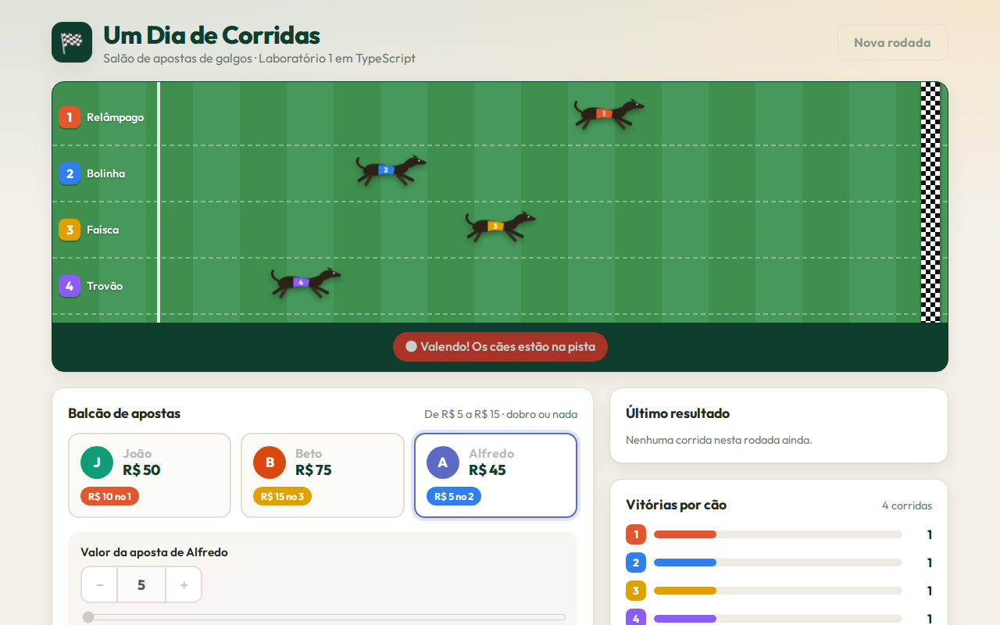

# Corrida de Cachorro TS — Um Dia de Corridas



Laboratório 1 do **Use a Cabeça! C#** reescrito em **TypeScript**: um simulador de corrida de galgos com salão de
apostas para três apostadores. Front em React + Vite, API em Fastify, Postgres com Kysely e tudo sobe com Docker.

## Rodar

Pré-requisito: Docker com Compose. Não precisa de Node na máquina.

```bash
cp .env.example .env          # opcional: os valores padrão já funcionam
docker compose up -d          # ou: make up
```

- Jogo: http://localhost:5173
- API (pelo proxy do Vite): http://localhost:5173/api/health
- Banco: `docker compose exec db psql -U lab` (banco e API não publicam porta, para não brigar com outros projetos)
- Produção (nginx + Node compilado): `make prod` → http://localhost:8080

## Regras

- João começa com R$ 50, Beto com R$ 75 e Alfredo com R$ 45.
- Aposta de R$ 5 a R$ 15, uma por pessoa por corrida, só com saldo. As apostas fecham quando a corrida começa.
- Dobro ou nada: quem acerta ganha o valor apostado, quem erra perde o valor apostado.
- Os 4 cães avançam de 1 a 4 casas por passo; se dois cruzam juntos, o vencedor é sorteado entre eles.
- Cada corrida e suas apostas ficam no Postgres (sobrevivem a `docker compose down` e `up`).

## Estrutura

```
packages/domain/   Greyhound, Guy, Bet e Race em TS puro + testes (Vitest)
apps/web/          React + Vite: pista, balcão de apostas e histórico
apps/api/          Fastify + Kysely: /api/races, /api/stats, migrations
e2e/               Playwright (ponta a ponta e o print do README)
docs/cronograma.md plano dos três laboratórios
```

## Desenvolvimento

```bash
git config core.hooksPath .githooks   # ativa os hooks de commit e push
make check                            # ESLint + tsc + Vitest no container
```

Branches `feature/<nome>`, commits `tipo(escopo): descrição` com até 6 arquivos. Detalhes na skill
`.claude/skills/lab-ts/SKILL.md`.

## Testes

```bash
make check       # ESLint + tsc + Vitest (domínio, tela com jsdom e unitários da API), no container
make test-int    # API contra o Postgres real, no banco lab_test (precisa do `docker compose up -d`)
make e2e         # Playwright no Docker contra http://web:5173 (precisa do app no ar)
make screenshot  # refaz docs/screenshot.png: joga até o meio da corrida em 1280×800
```
